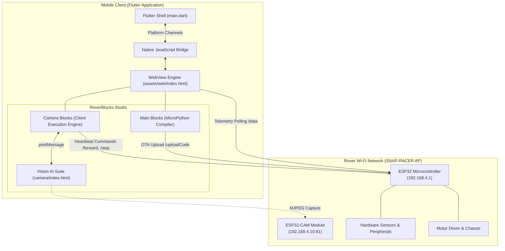

# CAR BOT — Snap Racer (SRV 2.0) Controller Application

[](https://flutter.dev)
[](https://espressif.com)
[](https://developers.google.com/blockly)
[](https://www.tensorflow.org/js)
[](LICENSE)

CAR BOT (Snap Racer Rover 2.0) is a cross-platform robotics controller and visual programming environment developed with Flutter, modern web technologies, Google Blockly, and browser-based computer vision engines. The platform supports real-time telemetry streaming, low-latency Wi-Fi driving controls, live FPV video monitoring, modular hardware sensor integration, and dual-execution visual programming supporting both on-hardware MicroPython execution and app-side vision logic.

---

## System Overview

### Driving Interfaces
- **Directional D-Pad**: Standard digital directional inputs (Forward, Reverse, Left, Right, Stop) with adjustable PWM motor speed scaling (0–255).
- **Cockpit Steering Simulation**: Virtual steering wheel interface paired with analog-style acceleration and braking inputs.
- **Inertial Gyroscope Steering**: Orientation-based vehicle steering leveraging device accelerometer and gyroscope hardware.
- **Heartbeat Safety Protocol**: Continuous 250ms interval command transmission ensuring reliable rover motion while preventing hardware watchdog timeouts.

### Video Telemetry & Streaming
- Low-latency real-time video streaming sourced from an on-board ESP32-CAM module (`http://192.168.4.10:81/stream`).
- Diagnostic reconnection routines and stream status monitoring.
- Multi-source camera selection: Device Front Camera, Device Rear Camera, and ESP32-CAM stream.

### Modular Peripheral Support
Support for hot-swappable I2C, PWM, and GPIO hardware accessories:
1. **VL53L0X Time-of-Flight Distance Sensor**: Millimeter-level proximity telemetry.
2. **DHT11 / DHT22 Sensor**: Ambient temperature and relative humidity tracking.
3. **LDR Light Sensor**: Ambient illumination monitoring.
4. **WS2812B NeoPixel Ring**: Visual lighting profiles (Auto Drive, Tachometer, Strobe, Rainbow, Chase, Breathing), 24-bit RGB customization, and brightness scaling.
5. **SSD1306 128x64 OLED Display**: Configurable graphical modes including reactive expression states and mini-game displays.
6. **MPU6050 / ADXL345 Inertial Measurement Units**: Vehicle pitch, roll, and dynamic tilt metrics.
7. **PWM Servo Actuators**: Absolute position control across preset angles (0° to 180°).

---

## RoverBlocks Studio

RoverBlocks Studio provides two isolated execution models designed to balance hardware constraints with advanced computing tasks:

### 1. Main Blocks Mode (Autonomous MicroPython Upload)
- **Target**: On-board ESP32 microcontroller runtime.
- **Compilation**: Translates visual block logic into MicroPython scripts.
- **Deployment**: Over-The-Air (OTA) deployment via `POST /uploadCode` executes programs directly on the vehicle microcontroller.
- **Hardware Coverage**: Full direct control over motor drivers, digital I/O, I2C bus sensors, and display peripherals.

### 2. Camera Blocks Mode (Local Application Execution)
- **Target**: Local Flutter/WebView client engine with zero processing overhead on the ESP32.
- **Transpilation**: Translates Python logic into asynchronous JavaScript executed within the client environment.
- **Command Transmission**: Dispatches low-latency directional commands (`/forward`, `/backward`, `/left`, `/right`, `/stop`) accompanied by an active 250ms keep-alive heartbeat.
- **State Latching**: Latches vision detection parameters (grid coordinates, gesture classes, finger counts) to prevent transient frame drops from prematurely halting vehicle motion.
- **Workspace Isolation**: Automatically validates block structures, disallowing direct micro-level sensor calls that require on-board execution.

---

## Computer Vision Suite

Integrated directly within Camera Blocks is a client-side computer vision subsystem:

| Module | Purpose | Underlying Technology |
| :--- | :--- | :--- |
| **Finger Tracking** | Hand landmark detection with 0–5 finger counting. | MediaPipe Hands |
| **Gesture Classifier** | Dynamic gesture categorization based on normalized hand coordinates. | KNN Classifier |
| **Image Classifier** | Multiclass visual classification trained interactively in-browser. | TensorFlow.js + MobileNet |
| **RGB Coordinates** | Real-time color centroid extraction and bounding box sizing. | HSV Segmentation Pipeline |
| **RGB Color Picker** | Click-to-lock color profile sampling with live feedback. | HSV Segmentation Pipeline |
| **RGB 3x3 Grid** | 9-cell spatial partitioning for visual navigation and grid indexing (1–9). | HSV Segmentation Pipeline |

- **Two-Way Workspace Synchronization**: Adding or inspecting camera blocks dynamically switches the active vision module in the preview frame via HTML5 `postMessage`.
- **Viewport Management**: Interface controls allow minimizing the video feed to preserve workspace area while maintaining active frame processing.

---

## Architecture & Network Topology



---

## REST API Reference

Client commands communicate with the primary controller endpoint at `http://192.168.4.1`:

| Endpoint | Method | Parameters | Description |
| :--- | :---: | :--- | :--- |
| `/ping` | `GET` | — | Link verification and connection health check |
| `/forward`, `/backward`, `/left`, `/right` | `GET` | — | Directional movement trigger |
| `/stop` | `GET` | — | Immediate motor halt |
| `/setSpeed` | `GET` | `?pwm=0..255` | Adjusts base motor PWM throttle |
| `/setFrontLed` | `GET` | `?state=0\|1` | Toggles vehicle illumination LEDs |
| `/setMode` | `GET` | `?mode=<name>` | Sets active modular sensor profile |
| `/setServo` | `GET` | `?angle=0..180` | Sets servo deflection angle |
| `/setRgb` | `GET` | `?mode=<mode>` | Selects active RGB animation profile |
| `/setRgbBrightness` | `GET` | `?b=0..255` | Adjusts RGB LED brightness |
| `/setOledConfig` | `GET` | `?mode=0..5` | Configures OLED graphics rendering mode |
| `/data` | `GET` | — | Retrieves aggregate telemetry payload |
| `/uploadCode` | `POST` | Python payload | Transmits and starts on-board Python script |
| `/stopCode` | `GET` | — | Terminates on-board script execution |

---

## Installation & Setup

### Requirements
- Flutter SDK (version 3.13.4 or higher)
- Android SDK & Build Tools (API Level 21+)
- Android or iOS physical device / emulator

### 1. Repository Setup
```bash
git clone https://github.com/Mitheshjn/CarBot.git
cd CarBot
flutter pub get
```

### 2. Verify Asset Declaration
Confirm that `pubspec.yaml` contains required asset paths:
```yaml
flutter:
  uses-material-design: true
  assets:
    - assets/web/
    - assets/web/camera/
```

### 3. Application Execution
```bash
flutter run
```

### 4. Production Build
```bash
flutter build apk --release
```
The compiled binary will be located at `build/app/outputs/flutter-apk/app-release.apk`.

---

## Documentation

For hardware assembly, network configuration, and instructional workflows, consult **[GUIDE.md](file:///e:/qtblocks-mobile/GUIDE.md)**.
