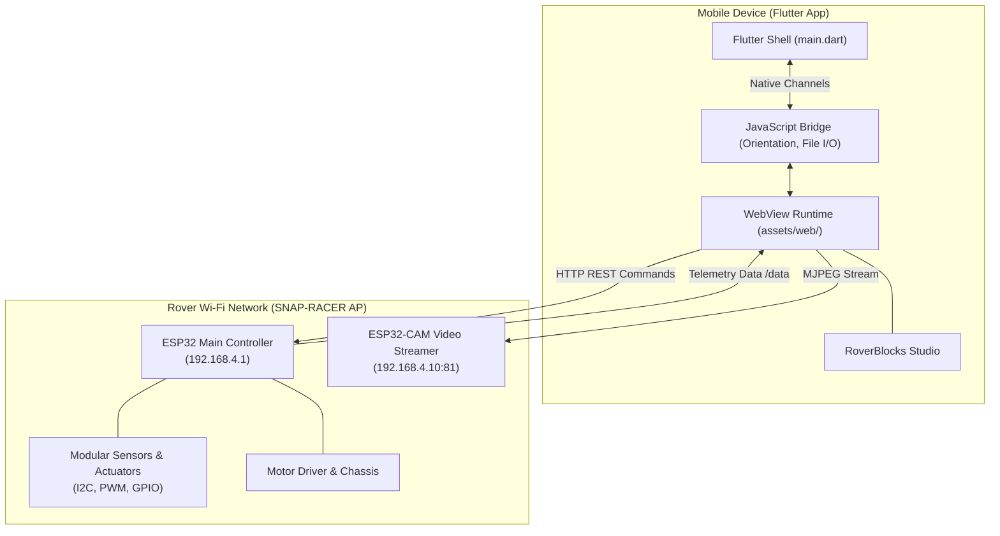

# 🏎️ CAR BOT — Snap Racer (SRV 2.0) Controller App

[](https://flutter.dev)
[](https://espressif.com)
[](https://developers.google.com/blockly)
[](LICENSE)

**CAR BOT** (Snap Racer Rover 2.0) is a high-performance cross-platform controller application built with **Flutter** and modern web technologies. It provides real-time telemetry, low-latency Wi-Fi driving controls, live FPV video streaming, modular hardware plug-and-play sensor management, and an integrated **Blockly Studio** to program the rover in Python visually.

---

## 🌟 Key Features

### 🕹️ Dual Driving Modes
- **Classic D-Pad**: Intuitive on-screen directional buttons (Forward, Reverse, Left, Right, Brake) with precision PWM speed throttle (0–255).
- **Cockpit Steering Wheel**: Interactive rotating steering wheel interface.
- **Gyroscope Tilt Steering**: Drive the rover naturally using your smartphone's internal motion sensors.
- **Gas & Reverse Pedals**: Analog-feel acceleration and regenerative braking simulation.

### 📹 Live FPV Video Streaming
- Low-latency real-time video stream directly from the on-board **ESP32-CAM** (`http://192.168.4.10:81/stream`).
- Quick-reload stream button and camera offline fallback diagnostics.

### 🔌 Modular Sensor Port & Smart Add-Ons
Hot-swappable sensor and peripheral support with automatic telemetry readouts:
1. **VL53L0X Time-of-Flight Distance Sensor**: Real-time millimeter-accurate distance telemetry.
2. **DHT11 / DHT22**: Ambient temperature and humidity monitoring.
3. **LDR Light Sensor**: Real-time ambient light tracking.
4. **WS2812B RGB NeoPixel Ring**: Multiple animation modes (*Auto Drive, Tachometer, Police, Rainbow, Chase, Breathing*), custom 16-million color hex picker, and brightness slider.
5. **SSD1306 128x64 OLED Display**: Dynamic interactive modes (*Animated Robot Face reacting to drive direction, Chrome Dino, Space Invaders*).
6. **ADXL345 / MPU6050 Accelerometer**: Vehicle tilt, pitch, and roll detection.
7. **Servo Motor Control**: Preset angle buttons (0°, 45°, 90°, 135°, 180°).

### 🧩 RoverBlocks Studio (Visual Programming)
- Integrated **Google Blockly** environment with custom Snap Racer hardware blocks.
- **Python Code Generation**: Real-time preview of Python code generated from block logic.
- **Native File Picker & Saver**: Load and save block programs (`.xml`) directly to Android device downloads via native bridge.
- **Over-The-Air (OTA) Program Execution**: Upload and execute Python programs directly onto the car hardware with a single tap.

### 📱 Native Flutter Bridge Integrations
- **Orientation Lock**: Dynamic toggling between portrait and landscape modes with native screen locking.
- **Direct Public Storage Access**: Android downloads directory integration (`/storage/emulated/0/Download`) without browser sandbox restrictions.
- **One-Tap App Reload**: Instant soft-reset of the controller interface.

---

## 🏗️ Architecture & Network Topology



---

## 📡 Hardware REST API Reference

The app communicates with the main ESP32 web server at `http://192.168.4.1`:

| Endpoint | Method | Parameters | Description |
| :--- | :---: | :--- | :--- |
| `/ping` | `GET` | — | Connection health check and heartbeat |
| `/forward`, `/backward`, `/left`, `/right` | `GET` | — | Directional movement commands |
| `/stop` | `GET` | — | Emergency motor brake |
| `/setSpeed` | `GET` | `?pwm=0..255` | Adjust motor PWM throttle |
| `/setFrontLed` | `GET` | `?state=0\|1` | Toggle front LED headlights |
| `/setMode` | `GET` | `?mode=<name>` | Set modular sensor port profile |
| `/setServo` | `GET` | `?angle=0..180` | Set servo horn position in degrees |
| `/setRgb` | `GET` | `?mode=<mode>` | Change RGB LED ring animation pattern |
| `/setRgbBrightness` | `GET` | `?b=0..255` | Set LED brightness |
| `/setOledConfig` | `GET` | `?mode=0..5` | Set OLED screen graphics mode |
| `/data` | `GET` | — | Polling telemetry sensor readings |
| `/uploadCode` | `POST` | Python script body | Upload and run custom script on the car |
| `/stopCode` | `GET` | — | Abort running Python script on the car |

---

## 🚀 Getting Started & Installation

### Prerequisites
- [Flutter SDK](https://docs.flutter.dev/get-started/install) (>= 3.13.4)
- Android SDK & Android Studio (for Android build)
- Physical Android/iOS device or emulator

### 1. Clone & Install Dependencies
```bash
git clone <repository-url>
cd flutter_application_1
flutter pub get
```

### 2. Verify Assets
Ensure that `pubspec.yaml` points to the web assets:
```yaml
flutter:
  uses-material-design: true
  assets:
    - assets/web/
```

### 3. Run the App
Connect your mobile device or launch an emulator:
```bash
flutter run
```

### 4. Build Production APK
```bash
flutter build apk --release
```
The output APK will be generated at `build/app/outputs/flutter-apk/app-release.apk`.

---

## 📖 Complete User & Setup Guide

For step-by-step instructions on connecting to the car's Wi-Fi network, troubleshooting communication issues, and using RoverBlocks Studio, see the **[GUIDE.md](file:///c:/Users/devan/OneDrive/Desktop/SRV2.0%20app/flutter_application_1/GUIDE.md)**.
